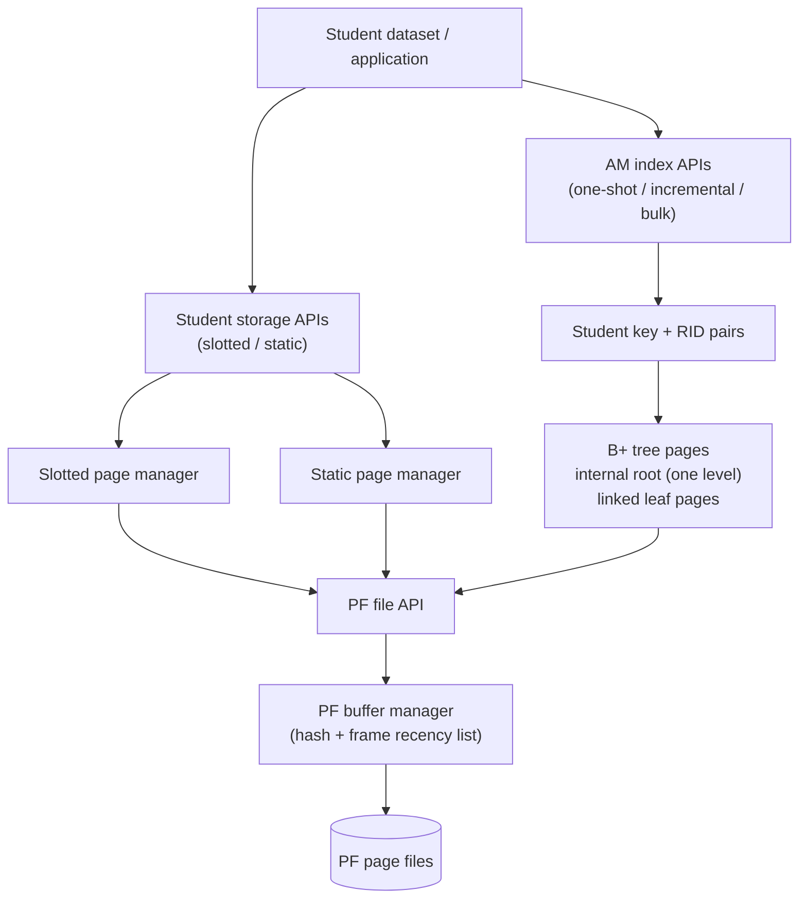
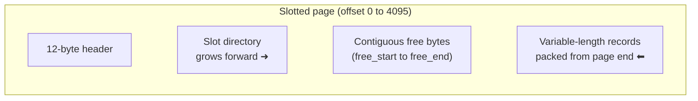
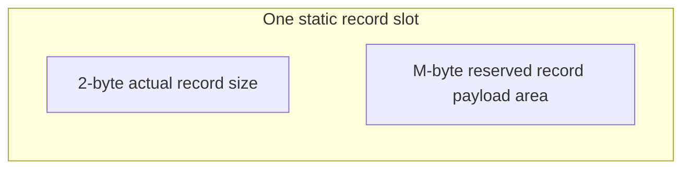
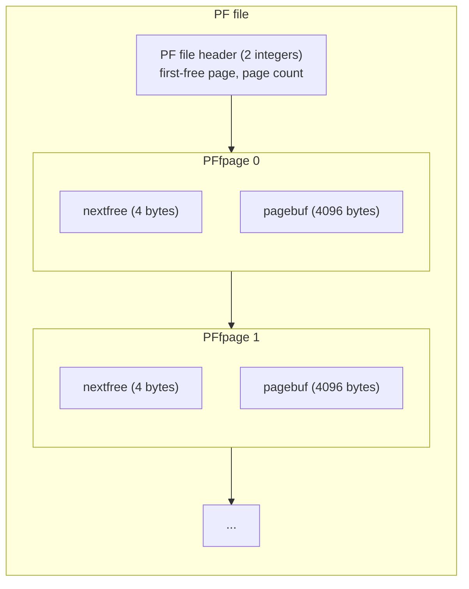
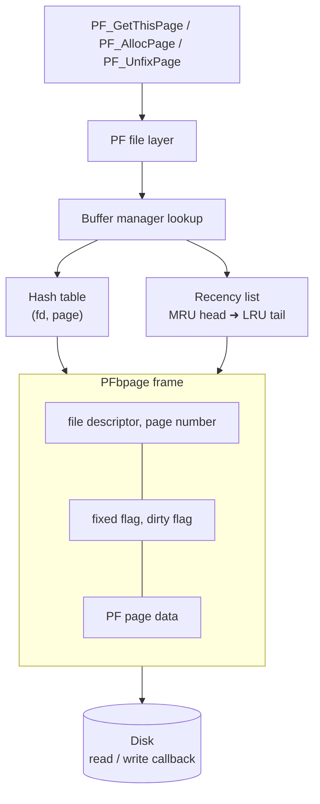
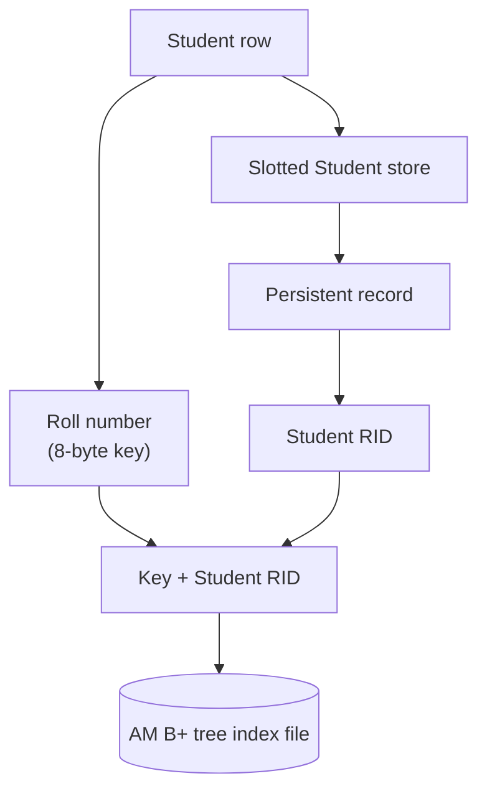

# ToyDB DBMS Project
## Integrated Technical Report: PF Buffer Management, Page Storage, and B+ Tree Access Methods

**Project:** ToyDB DBMS Assignment  
**Components:** Paged File (PF), slotted/static storage, and Access Method (AM)  
**Dataset:** Supplied Student relation (`data/student.txt`)  
**Page size:** 4,096 bytes  
**Implementation language:** C  
**Experiment tooling:** Python 3, Matplotlib, and OpenPyXL  
**Validation snapshot:** 6 November 2026

**Module guides:** [`pflayer/README.md`](pflayer/README.md) · [`slottedpage/README.md`](slottedpage/README.md) · [`amlayer/README.md`](amlayer/README.md)  
**Benchmark guide:** [`amlayer/AM_BENCHMARK_README.md`](amlayer/AM_BENCHMARK_README.md)

---

## Abstract

This report documents the architecture, implementation decisions, validation, and experimental evaluation of the integrated ToyDB DBMS assignment. It covers three cooperating subsystems: the Paged File (PF) layer and configurable buffer manager; persistent Student-record storage using slotted pages and fixed-slot static pages; and the Access Method (AM) layer used to build and search Student B+ tree indexes.

The storage evaluation uses 17,813 records from `data/student.txt`, representing 1,759,011 bytes of record payload. The PF-backed slotted store uses 454 data pages and achieves 94.59% payload utilization. The best tested static configuration (`M=108`) uses 482 pages and achieves 89.10%. The PF experiments compare LRU and MRU over buffer capacities of 2, 4, 8, and 16 pages, and also evaluate five read/write mixes with a three-page buffer. The AM experiments compare one-shot insertion, incremental insertion, and sorted bulk loading, with 30 duplicate-key query measurements per construction method.

The report explains the page formats, buffer-frame and replacement-policy structure, AM leaf/internal-page organization, duplicate-key handling, root-capacity safeguards, scan traversal, experiment methodology, measured results, and test coverage. Results are deliberately interpreted within the limits of the tested datasets and access sequences. The current bulk loader supports a one-level internal root; multi-level internal-node construction is not implemented.

---

## 1. Executive Summary

The storage component implements and tests two page-level organizations for the same Student records.

### 1.1 Slotted-page storage

A slotted page contains a 12-byte header, a forward-growing array of 4-byte slot descriptors, and packed record bytes growing backward from the end of the page. Each slot stores a record's offset and actual length. Deletion leaves a tombstone so that the slot number of every surviving record remains stable. Compaction reclaims fragmented record space while preserving slot identifiers.

The page-level implementation is integrated with PF through `student_store.c/.h`. This wrapper provides PF-backed file creation/open/close, insertion, RID-based retrieval, deletion, compaction, and callback-driven sequential scanning.

### 1.2 Static-record storage

Static storage uses an 8-byte page header and fixed-size slots. Each slot reserves `M` bytes for record data and stores a 2-byte actual-length field. The maximum slot capacity is:

$$
C(M) = \left\lfloor\frac{4096-8}{M+2}\right\rfloor
$$

The implementation was tested for `M = 108, 112, 128, 160, 256`.

### 1.3 Experimental conclusion

| Configuration | PF pages | Allocated data-page bytes | Payload utilization |
|---|---:|---:|---:|
| Slotted pages | **454** | **1,859,584** | **94.59%** |
| Static `M=108` | 482 | 1,974,272 | 89.10% |
| Static `M=112` | 509 | 2,084,864 | 84.37% |
| Static `M=128` | 575 | 2,355,200 | 74.69% |
| Static `M=160` | 713 | 2,920,448 | 60.23% |
| Static `M=256` | 1,188 | 4,866,048 | 36.15% |

For the supplied dataset, slotted pages use 28 fewer pages than the best tested static configuration (`M=108`), a 5.81% reduction relative to that static page count. Payload utilization is higher by 5.49 percentage points.

These are space-allocation results. They do not, by themselves, prove that slotted pages are faster for all workloads.

### 1.4 PF buffer management

The PF buffer manager supports a configurable capacity (up to the existing 20-frame maximum), LRU and MRU replacement, fixed-page protection, dirty-page writeback, and counters for logical/physical I/O and buffer hits. Five PF correctness tests pass. For the fixed 12-reference capacity workload, increasing capacity from 2 to 8 pages reduces physical reads to five for both policies; increasing capacity further to 16 does not improve that sequence. A separate 20-operation read/write workload compares five read/write mixes using a three-page buffer.

### 1.5 AM/B+ tree indexing

The AM work covers one-shot index construction, incremental insertion, and sorted-file bulk loading. The bulk loader stores equal roll-number groups together in a leaf, links leaf pages, constructs a capacity-checked single internal root, and supports an `ALL` scan that discovers the first leaf by following `Child0`. The supplied data produces 71 leaf pages and 70 root separators. G1-G4 regression tests cover duplicate grouping, a synthetic page-boundary case, root overflow handling, and leftmost-leaf traversal.

### 1.6 Integrated status

The root build and test workflow covers PF, storage, and AM modules. The final validation run completed the PF correctness/experiment workflow, slotted/static storage tests, the three legacy AM tests, the AM benchmark, and the boundary/capacity regressions. The module-specific experiment runners also generated CSV, Excel, graph, and Markdown artifacts under `experiments/storage/`.

---

## 2. Scope, Objectives, and Current Project Status

### 2.1 Storage objectives addressed

The storage work covers:

1. A 4,096-byte slotted-page format for variable-length records.
2. Insertion, retrieval, deletion, tombstone reuse, and compaction.
3. PF integration and persistent Student-file storage.
4. RID-based retrieval and sequential scanning.
5. A static-record alternative with configurable maximum slot length.
6. Dataset-level validation and a comparison of space usage.

### 2.2 Integrated project status

The integrated project contains three implemented subsystems: PF file/buffer management, slotted/static Student storage, and AM/B+ tree indexing. Their module-specific designs and experiment results are included in Sections 15-18 of this report and in the module READMEs.

The PF buffer manager includes configurable capacity, LRU/MRU replacement, fixed-page protection, dirty writeback, and statistics. The slotted and static storage managers provide PF-backed persistence, RID retrieval, and scanning. The AM layer includes three construction paths, duplicate-aware sorted bulk loading, root capacity validation, and dynamic leftmost-leaf discovery.

Two items remain intentionally outside the implemented scope: the additional G5 error-handling/format-string cleanup was deferred, and G6 RID-to-Student payload verification was not added as a separate regression. Most importantly, the current sorted bulk loader creates a single internal root above the leaf level; it does not build multiple internal levels. These boundaries are stated explicitly rather than being presented as completed features.

---

## 3. System Architecture

### 3.1 Layered design

The storage design separates page organization from file management.



The AM index and Student data file are separate PF files. Leaf entries map a roll-number key to one or more Student RIDs; the RID is the physical page/slot locator in the Student storage file.

The page-level functions operate on a caller-provided 4,096-byte buffer. They do not open or write files. The store-level wrappers obtain PF pages, invoke the page-level functions, and unfix the pages with the appropriate dirty flag.

### 3.2 Main source modules

| File / directory | Responsibility |
|---|---|
| `pflayer/pf.c`, `pflayer/pf.h` | PF file creation/open/close, page allocation, page lookup, page disposal, and PF-to-buffer-manager calls |
| `pflayer/buf.c` | Buffer-frame lookup, allocation/replacement, fixed/dirty state, writeback, configurable capacity/policy, and statistics |
| `pflayer/hash.c` | Hash table mapping an open-file/page pair to a buffer frame |
| `pflayer/pftypes.h` | PF file-page, open-file, buffer-frame, hash-entry, and policy declarations |
| `slottedpage/slotted_page.c/.h` | Variable-length slotted-page initialization, insert/retrieve/delete/compact, and validation |
| `slottedpage/student_store.c/.h` | PF-backed slotted Student file and sequential scan |
| `slottedpage/static_page.c/.h` | Fixed-slot static-page operations |
| `slottedpage/static_store.c/.h` | PF-backed static-record store, scanning, and storage statistics |
| `slottedpage/rid.h`, `pf_api.h` | Shared RID encoder/decoder and typed legacy-PF declarations |
| `amlayer/am.c`, `amsearch.c`, `aminsert.c`, `amscan.c` | AM index lifecycle, search/routing, leaf insertion/deletion support, and index scans |
| `amlayer/test_student_am_bulk.c` | Student-specific sorted bulk loader and G1-G4 regressions |
| `experiments/storage/run_pf_experiments.py` | PF correctness/experiment automation and result generation |
| `experiments/storage/run_am_experiments.py` | AM regressions, benchmark execution, and result generation |
| `experiments/storage/generate_storage_comparison.py` | Storage test execution, accounting, CSV, and graph generation |

### 3.3 PF and buffer-manager boundary

The PF layer manages pages belonging to a PF file. The buffer manager holds a limited number of those pages in memory. In the shared PF implementation, the buffer capacity and replacement policy are configurable, with LRU and MRU supported.

The storage-space experiment counts **allocated PF data pages**. It does not count buffer frames. LRU/MRU selection can affect the number of PF-layer reads and writes under a workload, but it does not change the page format or the deterministic number of data pages needed to store this dataset.

The PF implementation exposes `PFbufSetCapacity()` and `PFbufSetPolicy()`. `PF_LRU` and `PF_MRU` select the replacement policy; the default policy is LRU and the default capacity is `PF_MAX_BUFS` (20 frames). Statistics can be reset and read through the PF buffer statistics interface. The PF replacement-policy and read/write experiment results are reported in Section 17 and documented in [`pflayer/README.md`](pflayer/README.md).

The storage-space comparison remains a separate measurement: it counts allocated 4,096-byte data pages and payload bytes, not buffer hits or page I/O. Buffer replacement policy affects the measured I/O behaviour for an access sequence, not the deterministic page count of the storage layout.

### 3.4 PF page-file representation

The storage modules work with a 4,096-byte PF page buffer. In the tested Linux build, each stored PF page also carries a 4-byte `nextfree` integer field, and the PF file begins with an 8-byte header. The estimated PF file size is:

$$
\text{PF file bytes} = (\text{data pages} \times 4096) + (\text{data pages} \times 4) + 8
$$

Payload utilization is calculated over allocated 4,096-byte data-page areas only. The PF wrapper and file-header bytes are additional file-format overhead and are not part of the payload-utilization denominator.

---

## 4. Dataset Description and Input Handling

The supplied Student file is located at `data/student.txt`.

| Property | Measured value |
|---|---:|
| Data records, excluding first descriptive line | 17,813 |
| Record payload, excluding line terminators | 1,759,011 bytes |
| Average payload per record | Approximately 98.75 bytes |
| PF page size | 4,096 bytes |

The dataset test programs skip the first descriptive line. They remove `\n` and `\r` from each record before insertion and ignore empty trailing lines. The Python experiment runner independently reads the source file, counts the records, sums the record bytes, and validates the expected 16-field semicolon-separated structure.

The measured payload is the sum of the Student record bytes only. CR/LF line terminators are not stored as part of the records and are therefore excluded from the payload calculation.

---

## 5. Slotted-Page Design

### 5.1 Page layout

Every slotted page is 4,096 bytes.

The page header is 12 bytes:

| Header field | Width | Meaning |
|---|---:|---|
| Magic value | 4 bytes | Identifies a valid slotted page |
| `slot_count` | 2 bytes | Number of slot descriptors, including deleted slots |
| `live_count` | 2 bytes | Number of non-deleted records |
| `free_start` | 2 bytes | Beginning boundary of the contiguous free region |
| `free_end` | 2 bytes | End boundary of the contiguous free region |
| **Total** | **12 bytes** | |

Each slot descriptor is 4 bytes:

| Slot field | Width | Meaning |
|---|---:|---|
| `offset` | 2 bytes | Starting byte offset of the record within the page |
| `length` | 2 bytes | Actual record length; zero indicates a tombstone |

The slot directory grows from the beginning of the page toward higher offsets. Record payload bytes are placed from the end of the page toward lower offsets.



`free_start` is determined by the header and slot-directory size. `free_end` identifies the boundary of the packed record region.

### 5.2 Insertion algorithm

For each insertion, `SP_InsertRecord()`:

1. Checks pointers, record length, and page validity.
2. Validates header metadata and live record boundaries.
3. Searches the slot directory for a tombstone.
4. Reuses the first deleted slot if one exists; otherwise, it allocates a new slot descriptor.
5. Computes the required space: record length, plus 4 bytes if a new descriptor is required.
6. Tests the contiguous free region.
7. If a fragmented page can fit the record after compaction, compacts and retries.
8. Copies the record bytes into the page, writes the slot descriptor, and updates the header.

The key space distinction is:

- **Reusing a tombstone:** no new slot descriptor is needed.
- **Creating a new slot:** an additional 4-byte descriptor is required.

The implementation therefore avoids unnecessarily growing the directory when a deleted slot is available.

### 5.3 Deletion and stable slot identifiers

Deletion marks the selected slot as:

```text
offset = 0
length = 0
```

The deleted record's former byte range is not necessarily reclaimed immediately. `live_count` decreases, but `slot_count` remains unchanged. This preserves the slot numbers of all other records.

This design is important for RID stability. If deletion compacted the directory by removing a descriptor, later slots would shift and previously issued RIDs could identify a different record.

### 5.4 Compaction

`SP_CompactPage()` rebuilds the page's record region using only live records:

1. It preserves the existing slot-directory positions.
2. It copies live record bytes into a compact region.
3. It updates each live slot's offset.
4. It leaves tombstones in their original slot positions.
5. It restores the page metadata consistently.

Compaction reclaims fragmentation while preserving slot numbers. The insert path can invoke compaction automatically when enough total free space exists but the current contiguous region is too small.

### 5.5 Validation

The page validator checks the magic value, header bounds, slot-directory boundary, live and total slot counts, record bounds, and overlap between live record regions. It rejects malformed pages and invalid or deleted slots rather than treating arbitrary bytes as records.

---

## 6. PF-Backed Slotted Student Store

### 6.1 Store lifecycle

The store API is implemented in `student_store.c/.h`.

A typical application lifecycle is:

1. Call `PF_Init()` once for the process.
2. Create a PF file with `SPStore_CreateFile()`.
3. Open it with `SPStore_Open()`.
4. Insert, retrieve, delete, compact, or scan records.
5. Close it with `SPStore_Close()`.

When a store is opened, the implementation traverses the existing PF pages, validates that they contain slotted pages, and remembers the last data page. This supports append recovery after closing and reopening the file.

### 6.2 Insert path

For insertion:

1. Fix the current PF page using `PF_GetThisPage()`.
2. Call `SP_InsertRecord()`.
3. If insertion succeeds, unfix the page with `dirty = TRUE`.
4. If the page is full, unfix it without marking it dirty.
5. Allocate a new PF page using `PF_AllocPage()`.
6. Initialize the page using `SP_InitPage()`.
7. Insert the record and mark the page dirty when unfixing it.
8. Encode and return the RID.

The dirty flag is significant: PF must be told when a page has changed so that the buffer manager can write it back when required.

### 6.3 RID encoding

The shared RID format is:

$$
RID = (pageNum \ll 10) \;|\; (slotNum + 1)
$$

The lower 10 bits store `slotNum + 1`. Zero is reserved as an invalid slot code. Decoding is:

```c
pageNum = rid >> 10;
slotNum = (rid & 1023) - 1;
```

The RID is a physical locator consisting of a PF page number and a zero-based slot number. It is not the Student roll-number key.

This integer format is used to maintain compatibility with the AM layer's RID interface.

### 6.4 Retrieval path

`SPStore_Get()` decodes the RID, fixes the referenced PF page, calls `SP_GetRecord()` for the decoded slot, and unfixes the page without marking it dirty. The returned bytes and actual record length are checked by the dataset test.

### 6.5 Sequential scan

`SPStore_Scan()` visits used PF pages in page order and slots in slot order:

1. Obtain the first page with `PF_GetFirstPage()`.
2. Read the slot count.
3. Attempt to retrieve each slot.
4. Skip deleted slots/tombstones.
5. Encode a RID for each live record.
6. Invoke the supplied callback.
7. Unfix the current page with `dirty = FALSE`.
8. Move to the next page with `PF_GetNextPage()`.

The callback can request continuation, successful early termination, or an error. The callback's record buffer is valid only while the callback is executing; data must be copied if it needs to be retained.

---

## 7. Static-Record Design

### 7.1 Page layout

Static pages use an 8-byte header:

| Header field | Width | Meaning |
|---|---:|---|
| Magic value | 4 bytes | Identifies the static page format |
| Maximum record length `M` | 2 bytes | Configured reserved record area |
| Record count | 2 bytes | Number of records stored on the page |
| **Total** | **8 bytes** | |

Each record slot stores a 2-byte actual-length field followed by a reserved `M`-byte data region:



If a record uses fewer than `M` bytes, the rest of the reserved area is padding. The actual-length prefix allows retrieval to return only the record's meaningful bytes.

### 7.2 Page capacity

The slot size is `M + 2` bytes. Given an 8-byte page header and a 4,096-byte page:

$$
C(M) = \left\lfloor\frac{4096-8}{M+2}\right\rfloor
$$

| `M` | Slot size | Maximum records per full page |
|---:|---:|---:|
| 108 | 110 bytes | 37 |
| 112 | 114 bytes | 35 |
| 128 | 130 bytes | 31 |
| 160 | 162 bytes | 25 |
| 256 | 258 bytes | 15 |

The number of PF data pages expected for `N` records is:

$$
Pages(M) = \left\lceil\frac{N}{C(M)}\right\rceil
$$

For `N = 17,813`, this gives 482, 509, 575, 713, and 1,188 pages for the five tested maximum record lengths, matching the PF-backed test output.

### 7.3 Static store operations

`static_store.c/.h` wraps the static page functions with PF file operations. It supports creating/opening/closing the static data file, appending records, retrieving by RID, scanning records, and collecting storage statistics.

The static store uses the same RID encoding as the slotted store, allowing the same page/slot concept to be passed through the AM-facing integer RID representation.

---

## 8. Experimental Methodology

### 8.1 Workload

Both record organizations were evaluated using the same 17,813 Student records and the same actual payload total of 1,759,011 bytes.

The slotted-page measurement is based on the PF-backed Student file. `test_student_pf` traverses the actual PF file and reports the number of allocated data pages. The in-memory `test_student_dataset` result is used as a cross-check; the experiment script requires the two counts to match.

For each static `M` value, `test_static_pf` inserts all records, closes and reopens the file, scans all records, verifies every saved RID retrieval, and reports the page/storage measurements.

### 8.2 Metrics

**Allocated data-page bytes**

$$
A = Pages \times 4096
$$

**Payload utilization**

$$
U_p = \frac{Payload}{A}\times100
$$

**Slotted-page overhead**

$$
H_s = 12(Pages) + 4(N)
$$

**Slotted occupied page bytes**

$$
O_s = Payload + H_s
$$

**Static reserved record bytes**

$$
R_M = N \times M
$$

**Static record padding**

$$
P_M = R_M - Payload
$$

**Static record-length metadata**

$$
L = 2N
$$

**Static occupied page bytes**

$$
O_M = R_M + L + 8(Pages)
$$

**Unused data-page bytes**

$$
F = A - O
$$

Payload utilization deliberately counts only actual Student bytes in the numerator. Slot descriptors, page headers, actual-length fields, and reserved padding are overhead.

### 8.3 Automated experiment pipeline

The script `experiments/storage/generate_storage_comparison.py` makes the experiment reproducible. It builds and runs the storage tests in a temporary copy, leaving the working source tree out of the experiment build path. It:

1. Locates and validates `student.txt`.
2. Executes `make clean`.
3. Runs the in-memory slotted dataset test.
4. Runs the PF-backed slotted insert/close/reopen/RID test.
5. Runs the full PF-backed slotted sequential scan.
6. Runs static page tests.
7. Runs PF-backed static tests for all five `M` values.
8. Saves all test output to `storage_test_results.txt`.
9. Parses measurements from the C test output.
10. Checks record counts, page counts, and byte-accounting equations.
11. Generates `storage_comparison.csv`.
12. Generates the page-allocation and payload-utilization graphs.
13. Generates `storage_comparison_notes.md`.

The slotted PF page count is extracted from `test_student_pf`; the in-memory page count is only a cross-check. Static page counts are extracted from the corresponding PF-backed static test outputs. The script does not insert the page-count measurements into the graph from handwritten constants.

---

## 9. Experimental Results

### 9.1 Summary table

| Configuration | Capacity / average | PF pages | Allocated data-page bytes | Payload utilization |
|---|---:|---:|---:|---:|
| Slotted pages | 39.24 records/page average | **454** | **1,859,584** | **94.59%** |
| Static `M=108` | 37 slots/page capacity | 482 | 1,974,272 | 89.10% |
| Static `M=112` | 35 slots/page capacity | 509 | 2,084,864 | 84.37% |
| Static `M=128` | 31 slots/page capacity | 575 | 2,355,200 | 74.69% |
| Static `M=160` | 25 slots/page capacity | 713 | 2,920,448 | 60.23% |
| Static `M=256` | 15 slots/page capacity | 1,188 | 4,866,048 | 36.15% |

### 9.2 Detailed accounting table

**Record-area accounting**

| Format | Payload bytes | Reserved record bytes | Record padding | Length metadata |
|---|---:|---:|---:|---:|
| Slotted | 1,759,011 | 1,759,011 | 0 | 0 |
| Static 108 | 1,759,011 | 1,923,804 | 164,793 | 35,626 |
| Static 112 | 1,759,011 | 1,995,056 | 236,045 | 35,626 |
| Static 128 | 1,759,011 | 2,280,064 | 521,053 | 35,626 |
| Static 160 | 1,759,011 | 2,850,080 | 1,091,069 | 35,626 |
| Static 256 | 1,759,011 | 4,560,128 | 2,801,117 | 35,626 |

**Page-structure accounting**

| Format | Page headers | Slot directory | Occupied page bytes | Unused page bytes |
|---|---:|---:|---:|---:|
| Slotted | 5,448 | 71,252 | 1,835,711 | 23,873 |
| Static 108 | 3,856 | 0 | 1,963,286 | 10,986 |
| Static 112 | 4,072 | 0 | 2,034,754 | 50,110 |
| Static 128 | 4,600 | 0 | 2,320,290 | 34,910 |
| Static 160 | 5,704 | 0 | 2,891,410 | 29,038 |
| Static 256 | 9,504 | 0 | 4,605,258 | 260,790 |

The table distinguishes two types of space waste:

- **Record padding** is inside the reserved static slots. It is counted as occupied slot space, but it does not contain Student payload.
- **Unused page bytes** are the remaining bytes in allocated PF data pages after subtracting the page structures and reserved slots.

This distinction explains why a configuration can have large record padding but relatively few unused page bytes: the padding is already inside the reserved slots.

### 9.3 Generated graph: allocated pages


### 9.4 Generated graph: payload utilization


The source measurements and full experiment output are retained in:

- `experiments/storage/slotted_page/storage_comparison.csv`
- `experiments/storage/slotted_page/storage_test_results.txt`
- `experiments/storage/slotted_page/storage_comparison_notes.md`

The estimated PF file sizes, including the 4-byte per-page wrapper field and 8-byte file header, are:

| Configuration | Estimated PF file size |
|---|---:|
| Slotted pages | 1,861,408 bytes |
| Static `M=108` | 1,976,208 bytes |
| Static `M=112` | 2,086,908 bytes |
| Static `M=128` | 2,357,508 bytes |
| Static `M=160` | 2,923,308 bytes |
| Static `M=256` | 4,870,808 bytes |

The static-file estimates agree with earlier retained-file `stat` checks. The primary comparison metric remains payload bytes divided by allocated 4,096-byte data-page bytes.

---

## 10. Analysis and Discussion

### 10.1 Page-count comparison

Slotted pages allocate 454 PF data pages. Static `M=108`, the best of the tested static settings, allocates 482 pages.

The difference is:

$$
482 - 454 = 28 \text{ pages}
$$

Relative to the static `M=108` page count:

$$
\frac{482-454}{482}\times100 \approx 5.81\%
$$

The slotted implementation therefore uses 28 fewer pages, or approximately 5.81% fewer data pages, than the best tested static configuration.

### 10.2 Payload-utilization comparison

For slotted pages:

$$
U_{slotted} =
\frac{1,759,011}{454\times4,096}\times100
\approx 94.59\%
$$

For static `M=108`:

$$
U_{108} =
\frac{1,759,011}{482\times4,096}\times100
\approx 89.10\%
$$

The difference is approximately:

$$
94.59 - 89.10 = 5.49
$$

Thus, slotted storage improves payload utilization by about **5.49 percentage points** for this dataset.

### 10.3 Effect of increasing the static maximum record length

Static storage reserves `M` bytes per record, regardless of the record's actual length. Increasing `M` has two linked effects:

1. The slot size `M+2` increases.
2. Fewer slots fit in one 4,096-byte page.

As a result, the number of allocated pages grows from 482 at `M=108` to 1,188 at `M=256`. Record padding also grows from 164,793 bytes to 2,801,117 bytes.

The largest tested configuration therefore allocates more than twice as many pages as slotted storage and has only 36.15% payload utilization.

### 10.4 Why the slotted-page directory is worthwhile

Slotted pages pay for a 4-byte offset/length descriptor per slot and a 12-byte page header. In return, they store each record at its actual length and do not reserve the same maximum-width area for every record.

For variable-length Student records, that trade-off is favourable in the measured dataset. The page directory allows records to be located even though the payloads have different lengths. Tombstones and compaction allow deletion without renumbering surviving slots.

### 10.5 Scope of the conclusion

The experiment demonstrates space efficiency for the supplied Student dataset and the tested static values of `M`. It does not measure CPU time, insertion latency, lookup latency, deletion cost, or sequential-scan throughput. Those would require separate performance workloads and measurements.

The result should therefore be stated narrowly: **slotted pages are more space-efficient than the tested static-record configurations for this Student dataset under the payload-utilization and page-count metrics used here.**

---

## 11. Testing and Validation

### 11.1 Page-level slotted-page tests

The page-level tests cover initialization, header metadata, variable-length insertion, retrieval, invalid inputs, full-page handling, tombstone creation, slot reuse, compaction, stable slot identifiers, and malformed/overlapping page detection.

The Phase 2 regression suite reports **7/7 tests passed**.

### 11.2 PF integration tests

The PF integration tests validate:

- PF file creation and page allocation.
- Multi-page record insertion.
- RID-based retrieval across pages.
- Close/reopen persistence.
- Append recovery after reopening.
- Deletion and compaction persistence.
- Reuse of deleted slots/RIDs after reopening.

A synthetic PF integration test inserts 250 records and verifies an append after reopening.

### 11.3 Full Student dataset: slotted storage

The PF-backed Student test:

1. Reads the dataset, skipping its descriptive first line.
2. Inserts each Student row.
3. Saves the RIDs and original record bytes.
4. Closes and reopens the PF file.
5. Retrieves each record through its RID.
6. Compares the retrieved bytes and lengths against the original input.

All **17,813 records** were verified. The test also traverses PF pages to count the actual PF data pages. The measured PF count is 454 and matches the in-memory slotted-page count.

### 11.4 Sequential scan tests

The synthetic scan test inserts 250 records, deletes 4, and verifies that 246 live records are returned. It also tests empty files, multiple pages, deletion/compaction, persistence across reopen, RID/record matching, and callback-controlled early termination.

The full dataset scan returns all 17,813 records, with **zero missing or extra records**.

### 11.5 Static-record tests

The page-level tests pass for `M=108,112,128,160,256`.

For every PF-backed static configuration:

- 17,813 records are inserted.
- The file is closed and reopened.
- 17,813 records are scanned.
- 17,813 RID-based retrievals are verified.
- No missing, extra, or mismatched records are reported.

### 11.6 Integrated regression

After the PF changes from the shared main branch were merged into the slotted-page feature branch, the storage suite and unified storage experiment were rerun successfully. The storage report's PF-backed page counts therefore come from the integrated working tree, not only the original PF implementation.

---

## 12. Reproducibility

### 12.1 Prerequisites

- Linux environment.
- C compiler and `make`.
- Python 3 with `venv` and `pip`.
- Matplotlib and OpenPyXL for experiment graphs/workbooks.
- Supplied `data/student.txt`.

On Ubuntu, install the build and Python environment tools:

```bash
sudo apt update
sudo apt install build-essential make python3 python3-venv python3-pip
```

From the repository root, create the virtual environment and install the shared experiment dependencies:

```bash
python3 -m venv .venv
source .venv/bin/activate
python -m pip install --upgrade pip
python -m pip install -r toydb/experiments/storage/requirements.txt
```

### 12.2 Run storage regression tests

From the repository root:

```bash
cd toydb/slottedpage
make clean
make test STUDENT_FILE=../../data/student.txt
```

### 12.3 Re-run the complete storage comparison

From the repository root:

```bash
python3 toydb/experiments/storage/generate_storage_comparison.py
```

For an alternate dataset path:

```bash
python3 toydb/experiments/storage/generate_storage_comparison.py \
    --student-file /absolute/path/to/student.txt
```

The script runs the C tests, captures the output, parses the actual measurements, validates the accounting, and recreates the CSV, graphs, and notes.

### 12.4 Inspect one retained static PF file

The static PF test normally removes its temporary database after verification. To retain one test file:

```bash
cd toydb/slottedpage
./test_static_pf ../../data/student.txt 128 --keep
ls -lh static_students_M128.pf
```

Remove retained test database files after inspection; they are generated data, not source files.

---

## 13. Storage-Specific Limitations

The storage-space experiment measures allocated PF data pages, payload utilization, reserved padding, and page-structure overhead. It does not compare insertion latency, lookup latency, deletion cost, CPU time, or scan throughput between slotted and static storage. Those are separate workload measurements and should not be inferred from page-count results.

The static comparison covers the selected maximum record lengths `M=108,112,128,160,256`; it does not establish that one of those values is optimal for every possible Student dataset. Likewise, the slotted-page space advantage is demonstrated for the supplied 17,813-record Student dataset and the reported accounting definitions.

PF I/O and AM index performance are evaluated separately in Sections 15-17. The AM-specific one-level-root limitation and deferred items are listed in Section 19.

---

## 14. Storage Subsystem Conclusion

The project implements two persistent Student-record storage alternatives over the ToyDB PF layer. The slotted-page design supports variable-length records, tombstone-based deletion, slot reuse, compaction, RID retrieval, and sequential scanning. The static-record design reserves a configurable maximum record area per slot and supports PF-backed insertion, retrieval, scanning, and storage measurement.

Both designs passed their page-level and PF-backed dataset tests. All 17,813 Student records were verified, including after close/reopen. The PF-backed slotted file uses 454 pages and achieves 94.59% payload utilization. The most efficient tested static configuration (`M=108`) uses 482 pages and achieves 89.10%. Larger static slot sizes increase padding, reduce slots per page, and require substantially more pages.

For the supplied variable-length Student dataset, slotted pages provide the best space utilization among the tested configurations. The unified experiment runner preserves the provenance of the measurements by extracting the page counts and storage figures from the C test output and regenerating the CSV and graphs from those measurements.

---

## 15. Paged File Layer and Buffer Manager

### 15.1 Responsibility and page-file representation

The PF layer is the common file/page interface used by both Student storage formats and the AM index files. It provides file creation, destruction, opening/closing, page allocation, page lookup, page disposal, and page unfix operations. The higher layers work with a `PF_PAGE_SIZE` page buffer; the tested build uses 4,096-byte page data.

The file representation has an 8-byte PF file header containing the first free-page link and the page count. Each on-disk PF page is represented by a 4-byte `nextfree` field followed by the 4,096-byte page buffer. The `nextfree` field participates in PF free-page management; it is not part of the slotted/static/AM page payload layout.



The PF layer therefore separates file-level bookkeeping from the 4,096-byte page buffer passed to a higher-level page manager.

\newpage

### 15.2 Buffer-frame architecture

The buffer manager keeps a bounded set of in-memory `PFbpage` frames. A frame records the owning file descriptor and page number, the page contents, and two state flags:

- `fixed`: the page is currently pinned by a caller and cannot be selected as a replacement victim.
- `dirty`: the page contents have been modified and must be written back before the frame is reused or released.

A hash table maps an `(open file descriptor, page number)` pair to its in-memory frame. This avoids scanning every frame to determine whether a requested page is already resident. A doubly linked used-frame list tracks recency. The list head is the most recently used end because newly linked/accessed frames are moved to the head; the tail is the least recently used end.



The hash table and recency list serve different purposes: the hash table locates a resident page, while the list identifies a replacement candidate. Frames marked `fixed` are skipped by the victim search. If every frame is fixed, allocation cannot safely evict a page and returns the buffer-exhaustion error.

### 15.3 Capacity and replacement-policy decisions

The implementation adds `PFbufSetCapacity()` and `PFbufSetPolicy()` without changing the 20-frame compile-time upper bound (`PF_MAX_BUFS`). The default capacity is 20 frames and the default policy is LRU. The configurable capacity is constrained to a positive value no greater than `PF_MAX_BUFS`, and it cannot be lowered below the number of frames already allocated.

The supported policy constants are:

| Policy | Value | Victim search |
|---|---:|---|
| `PF_LRU` | 0 | Scan from the list tail toward the head and choose the least-recently-used unfixed frame |
| `PF_MRU` | 1 | Scan from the list head toward the tail and choose the most-recently-used unfixed frame |

When the pool is below its configured capacity, a free frame is allocated. At capacity, the replacement search selects an unfixed victim. If the victim is dirty, the PF write callback is invoked before the frame is detached from its old page identity and reused. Dirty pages are also written as part of file-close/release handling. This preserves the rule that a modified page is not silently discarded.

The design exposes both LRU and MRU because their relative behaviour depends on the access sequence. The experiments do not assume one policy is universally superior.

### 15.4 Buffer statistics

The statistics interface provides reset, retrieval, and printing operations. The reported fields are:

| Metric | Meaning in the experiment output |
|---|---|
| Logical reads | Calls requesting pages through the PF buffer/page interface in the measured workload |
| Logical writes | Dirty-page unfix operations in the read/write workload |
| Physical reads | Page reads from the PF file into the buffer, as reported by the PF counters |
| Physical writes | Dirty-page writes to the PF file, including writeback on close where the workload collects counters after closing |
| Buffer hits | Requests satisfied by a page already resident in the buffer |
| Hit ratio | `buffer hits / logical reads * 100` for the given workload definition |

The PF workload runner explicitly notes that it calls `PF_GetThisPage()` once for every operation, including operations that subsequently modify the page. Thus `logical_reads` is 20 in every 20-operation read/write workload; the separate `read_operations` and `write_operations` fields describe the intended read/write mix. `logical_writes` counts dirty unfix operations.

### 15.5 PF correctness tests

The automated PF runner builds a temporary copy of the PF sources and executes five correctness tests:

1. `testhash` - hash-table/page lookup behaviour.
2. `testpf` - PF file/page operations, allocation, disposal, and retrieval.
3. `testbuf` - buffer capacity, fixed-page protection, hits, dirty eviction, close-time flush, replacement-policy selection, and invalid configuration.
4. `teststats` - logical/physical I/O counters, hits, and statistics reset.
5. `testlru` - strict LRU victim selection.

The supplied result file reports all five tests as passing with exit code zero. The PF Makefile also runs the capacity and read/write experiments described in Section 17.

---

## 16. Access Method Layer and Student B+ Tree Indexing

### 16.1 Role of the AM layer

The AM layer stores and searches indexes over keys while returning the record identifiers associated with those keys. For the Student dataset, the indexed key is the eight-character roll number extracted from the second semicolon-separated field. The Student record itself is stored through the slotted-page Student store; the AM leaf stores the roll-number key and the Student RID, rather than duplicating the full Student record.

This separation keeps the key lookup structure distinct from the record storage structure:



The RID is a physical locator encoded as `(pageNum << 10) | (slotNum + 1)`. It is not the roll number. The shared RID convention makes the AM result usable by the Student storage layer for record retrieval.

### 16.2 Leaf-page structure

An AM leaf page begins with `AM_LEAFHEADER`. Its fields include the page type (`'l'`), next-leaf page number, record-ID pointer, key pointer, free-list pointer and count, attribute length, current key count, and maximum-key metadata.

The sorted key entries grow forward from the leaf header. Each key entry stores the fixed-length key and a short pointer to the head of its RID list. RID-list nodes are allocated from the opposite end of the page; a node stores an integer RID and a short link to the next node. The leaf's `nextLeafPage` field links leaves in key order for range and `ALL` scans.

For a key that appears more than once, the leaf keeps one key entry and a linked list of all associated RIDs. `AM_FOUND` insertion prepends a new RID-list node to the existing key's list. The leaf free-list metadata supports reuse of released RID-list nodes; compaction can consolidate the RID-list region when required by the legacy insertion routines.

### 16.3 Internal-page layout and search routing

An internal page begins with `AM_INTHEADER` and stores child pointers interleaved with separator keys:


Each separator is the first key in the child immediately to its right. Search starts at the first PF page (the root), reads the internal header, binary-searches the separator keys, follows the selected child pointer, and repeats until it reaches a leaf. The leaf search then locates the key and its RID-list head. This is the routing convention used by the existing `AM_BinSearch()` and leaf-search routines.

### 16.4 Three index-construction paths

The assignment compares three ways of constructing the Student index:

| Method | Construction approach | Architectural distinction |
|---|---|---|
| One-shot insertion | Load the Student records first, then build the index by inserting their key/RID pairs | Separates record loading from index construction |
| Incremental insertion | Insert each key/RID pair into the index as Student records are loaded | Interleaves record storage and index maintenance |
| Sorted bulk loading | Store records and collect key/RID pairs, sort the pairs by roll number, then create leaf pages and the root in order | Uses sorted input to construct packed leaf pages directly |

The bulk loader is implemented in the Student-specific bulk test program. It reads the supplied dataset, skips its descriptive first line, parses the second field as the eight-character roll number, inserts the complete Student row into the slotted store, and retains the corresponding RID with the key. It sorts the `(roll number, RID)` entries before allocating and populating leaf pages. Leaf pages are linked using `nextLeafPage`; the root page is then populated with child pointers and the first key of each right child as separator.

### 16.5 G1 - duplicate-key groups remain in one leaf

A duplicate roll number must not be split across adjacent leaves. If only part of the duplicate group fit in the current leaf, the older implementation could create the same separator key in adjacent leaves and make equality routing ambiguous. The corrected bulk loader first determines the complete run of equal keys, calculates the space required for the whole group, and inserts all RIDs together. If the group does not fit in the remaining free space, the current leaf is finished and the whole group is retried on the next leaf. If the group cannot fit even in an empty leaf, construction fails rather than splitting it.

A leaf stores one distinct key entry and the associated RID-list nodes. The space calculation accounts for the key, its list-head pointer, and every RID/link node in the group.

### 16.6 G2 - synthetic duplicate-boundary regression

The synthetic regression creates a case that is not dependent on the incidental duplicate distribution of the supplied dataset. It places 253 distinct single-RID keys before a duplicate group of four RIDs. The constructed boundary leaves 24 bytes available, while the complete duplicate group requires 34 bytes. The test verifies that the group starts intact on the next leaf, that the preceding distinct key remains searchable, and that all four duplicate RIDs are returned. The `ALL` scan over the synthetic index returns all 257 entries.

### 16.7 G3 - root capacity validation and explicit tree-depth limit

For the current eight-byte roll-number key and the AM page-header layout, the single internal root can hold 340 separator keys and therefore 341 child-page pointers. The capacity is calculated from the available 4,096-byte page area rather than being treated as an unbounded structure. Root construction rejects more than 341 children before modifying the root page.

The capacity regression accepts exactly 341 children and verifies that a request for 342 is rejected without changing the existing root page. This is a deliberate bounded implementation: the bulk loader currently supports one internal root above the leaves. It does not allocate additional internal levels when the leaf count exceeds the root capacity.

The supplied Student dataset creates 71 leaf pages and 70 root separators, so it fits comfortably within the 341-child limit. The test's overflow case is a boundary/guard test, not evidence that multi-level construction is implemented.

### 16.8 G4 - dynamic leftmost-leaf discovery

The earlier scan implementation assumed that the first leaf always occupied PF page 2. That depended on a dummy page being reserved and was not a valid structural property of a B+ tree. The corrected `GetLeftPageNum()` starts from the root page and repeatedly reads the first child pointer (`Child0`) until it reaches a leaf. It validates page types and invalid/self child pointers and has a bounded descent guard.

The bulk-loader test no longer needs a dummy page between the root and first leaf. The `ALL` scan regression verifies that sequential index scanning begins at the structurally identified leftmost leaf and returns the expected number of entries.

### 16.9 AM validation scope

The automated AM experiment runner executes the three legacy correctness programs (`test1`, `test2`, and `test3`), then builds and runs the Student bulk-loader program in three modes: the full-dataset regression, the synthetic duplicate-boundary regression, and the root-capacity regression. The full-dataset run checks the known duplicated roll numbers `97305818`, `99302001`, and `99310001`, each expected twice, and verifies the full `ALL` scan count of 17,813. The other modes exercise G2/G4 and G3 respectively.

The additional G5 format-string/error-handling cleanup and the proposed G6 RID-to-Student payload cross-check were intentionally deferred from the chosen scope. This report does not claim that the separate G6 verification was completed.

---

## 17. PF and AM Experimental Results

### 17.1 PF capacity and replacement-policy experiment

The capacity experiment runs the same twelve-page-reference sequence for every combination of policy and capacity:

```text
0, 1, 2, 3, 0, 1, 4, 0, 1, 2, 3, 4
```

The policies are LRU and MRU; capacities are 2, 4, 8, and 16 frames. Each configuration performs 12 logical page requests. Physical writes are zero because this experiment only reads pages.

| Policy | Capacity (pages) | Logical reads | Physical reads | Hits | Hit ratio |
|---|---:|---:|---:|---:|---:|
| LRU | 2 | 12 | 12 | 0 | 0.00% |
| LRU | 4 | 12 | 8 | 4 | 33.33% |
| LRU | 8 | 12 | 5 | 7 | 58.33% |
| LRU | 16 | 12 | 5 | 7 | 58.33% |
| MRU | 2 | 12 | 10 | 2 | 16.67% |
| MRU | 4 | 12 | 6 | 6 | 50.00% |
| MRU | 8 | 12 | 5 | 7 | 58.33% |
| MRU | 16 | 12 | 5 | 7 | 58.33% |


For this specific sequence, increasing capacity from 2 to 8 reduces physical reads under both policies. At capacity 8, the buffer can retain the five distinct pages touched by the sequence; increasing capacity to 16 does not reduce physical reads further. MRU records fewer reads than LRU at capacities 2 and 4 in this sequence; at capacities 8 and 16, the results are identical. These observations are workload-specific and do not establish that MRU is generally better than LRU.

### 17.2 PF read/write workload experiment

The second PF workload uses five pages, a three-frame buffer, and 20 operations per workload. The read/write mix is changed while the page-access pattern remains cyclic. The C workload test calls `PF_GetThisPage()` once per operation and then either unfixes the page clean or modifies it and unfixes it dirty. Consequently, `logical_reads` is 20 in all rows; `logical_writes` tracks the number of dirty unfix operations. Physical write counters are collected after close so that dirty flushes at close are included.

| Workload | Policy | Logical reads | Logical writes | Physical reads | Physical writes | Hits | Hit ratio |
|---|---|---:|---:|---:|---:|---:|---:|
| 100R / 0W | LRU | 20 | 0 | 20 | 0 | 0 | 0.00% |
| 100R / 0W | MRU | 20 | 0 | 12 | 0 | 8 | 40.00% |
| 75R / 25W | LRU | 20 | 5 | 20 | 5 | 0 | 0.00% |
| 75R / 25W | MRU | 20 | 5 | 12 | 5 | 8 | 40.00% |
| 50R / 50W | LRU | 20 | 10 | 20 | 10 | 0 | 0.00% |
| 50R / 50W | MRU | 20 | 10 | 12 | 10 | 8 | 40.00% |
| 25R / 75W | LRU | 20 | 15 | 20 | 15 | 0 | 0.00% |
| 25R / 75W | MRU | 20 | 15 | 12 | 11 | 8 | 40.00% |
| 0R / 100W | LRU | 20 | 20 | 20 | 20 | 0 | 0.00% |
| 0R / 100W | MRU | 20 | 20 | 12 | 12 | 8 | 40.00% |


For this cyclic five-page workload with a three-page buffer, LRU records 20 physical reads and no hits for all five mixes. MRU records 12 physical reads and 8 hits for every mix. Physical writes rise with the number of write operations; the MRU 25R/75W and write-only cases record 11 and 12 physical writes respectively, while LRU records 15 and 20. Dirty pages may be written when evicted or when the file closes, so physical writes need not equal logical writes one-for-one. The measured result describes this test sequence and its buffer configuration, not all possible database workloads.

### 17.3 AM index-construction benchmark

The AM benchmark compares the three construction paths using the same Student dataset. The build-time measurement wraps the complete existing construction program; it includes Student record-storage preparation and the method-specific index construction. It is therefore an end-to-end measurement rather than a timer around only the B+ tree insertion loop.

| Construction method | End-to-end build time |
|---|---:|
| One-shot | 0.070 s |
| Incremental | 0.070 s |
| Sorted bulk load | 0.050 s |


The measured bulk-load run is 0.02 seconds lower than the one-shot and incremental runs in this validation snapshot. Since the measured durations are short and are single reported end-to-end values per method in the supplied `build_time.csv`, this should be treated as an observation for this run, not as a statistically established speedup.

### 17.4 AM duplicate-key query benchmark

The common equality query searches for roll number `97305818`, which occurs twice in the supplied dataset. Thirty independent measurements are collected per construction method. Each measurement is performed in a fresh process; the timed interval includes opening the index scan, retrieving the matching RIDs, and closing the scan. Process startup and opening the PF index file are outside the timed interval. The median is used for the reported latency.

| Construction method | Runs | Median query time | Median logical page accesses | Median physical page reads | Matches |
|---|---:|---:|---:|---:|---:|
| One-shot | 30 | 22 μs | 6 | 3 | 2 |
| Incremental | 30 | 28 μs | 6 | 3 | 2 |
| Sorted bulk load | 30 | 23 μs | 6 | 3 | 2 |


All three methods returned the expected two matching RIDs. The measured median logical and physical page-access counts are identical for the selected query. The latency differences are measured in single-digit microseconds and should not be over-interpreted. The raw 90 measurements are retained in `experiments/storage/am_layer/query_metrics.csv`.

### 17.5 Results interpretation boundaries

The storage experiment measures space allocation, not latency. The PF experiments use two short, fixed page-reference workloads and should not be generalized to arbitrary traces. The AM build times include Student storage preparation, and only one build-time value per method is retained in the supplied CSV. AM query latency is repeated 30 times per method, but all measurements target one duplicate key. These boundaries are necessary for a fair reading of the graphs and tables.

---

## 18. Integrated Build, Test, and Experiment Reproduction

### 18.1 Python environment

From the repository root, create and activate a virtual environment and install the experiment dependencies:

```bash
python3 -m venv .venv
source .venv/bin/activate
python -m pip install --upgrade pip
python -m pip install -r toydb/experiments/storage/requirements.txt
```

The requirements file includes Matplotlib for graph generation and OpenPyXL for Excel workbooks. The C build requires a compiler and Make; the scripts also use Python 3 and standard-library modules.

### 18.2 Run individual experiment workflows

Run these from the repository root:

```bash
# PF correctness tests plus capacity and read/write experiments
python toydb/experiments/storage/run_pf_experiments.py

# AM legacy tests, G1-G4 Student regressions, and B+ tree benchmarks
python toydb/experiments/storage/run_am_experiments.py --force

# Slotted/static storage tests, accounting, CSV, graphs, and notes
python toydb/experiments/storage/generate_storage_comparison.py --force
```

The PF and AM experiment runners compile and execute temporary project copies. The storage generator likewise performs its experiment build in a temporary copy. This prevents experiment-specific compilation and temporary data files from being mixed with the main working tree. Results are written under:

```text
toydb/experiments/storage/
    pf_layer/
    am_layer/
    slotted_page/
```

The `--force` flag reruns the experiment and replaces its generated results. Without it, a runner may validate a complete result set and skip unnecessary regeneration.

### 18.3 Root build and regression commands

The root Makefile provides the unified commands:

```bash
make build
make test
```

Module-focused tests can be run with:

```bash
make test-pf
make test-storage
make test-am
```

`make test` runs the PF, storage, and AM module workflows and prints `ALL TESTS COMPLETED` when the target sequence exits successfully. The submitted validation run showed the five PF correctness tests, PF capacity/read-write experiments, the slotted/static storage tests, the three legacy AM tests and benchmarks, the G2 duplicate-boundary/ALL-scan regression, and the G3 root-capacity regression completing successfully. The separate AM experiment runner also includes the full Student bulk-loader regression for G1/G4.

### 18.4 Clean generated build products

The root cleanup target delegates to the three component Makefiles:

```bash
make clean
```

It removes compiled objects and test executables, PF scratch files, and generated AM index/test data from the component directories. It does not remove the consolidated experiment result directories under `toydb/experiments/storage/`. To inspect the exact commands before executing cleanup, use:

```bash
make -n clean
```

The component clean rules should be reviewed whenever new generated files are added. Source files, README files, CSV results, graph images, and analysis notes are not build products and should remain outside the clean rules.

### 18.5 Validation snapshot

The integrated regression log ends with:

```text
========================================
 ALL TESTS COMPLETED
========================================
```

The storage experiment reports 17,813 records verified and 454 PF-backed slotted pages. The AM boundary regression reports 257 expected and actual entries; the capacity regression accepts 341 children and rejects 342 without modifying the root. The PF result bundle records five PF correctness tests as passing, eight capacity/policy configurations, and ten read/write/policy workload rows. Detailed machine-readable results and figures are retained beside the experiment runners.

---

## 19. Project Limitations and Deferred Work

1. **AM tree depth:** the sorted bulk loader builds leaf pages and one internal root. It safely rejects a root requiring more than 341 children; it does not yet construct additional internal levels.
2. **G5 cleanup:** additional AM error-handling and the legacy `misc.c` format-string cleanup were intentionally deferred from the selected scope. Any remaining compiler warnings should be reviewed separately if the course submission requires warning-free compilation.
3. **G6 RID content cross-check:** the test suite verifies known duplicate-key result counts and full index scans, while the storage tests verify their own RIDs against Student payloads. A dedicated end-to-end test that dereferences every AM-returned RID and rechecks its Student roll number was proposed but deferred.
4. **PF generalization:** LRU/MRU comparisons use the specified short access sequence and five-page read/write workload, not a representative production trace. Policy rankings may reverse on a different trace.
5. **AM benchmark scope:** the construction metric is end-to-end and the query benchmark uses one duplicate roll number. The measured differences should not be generalized to all keys or data distributions.
6. **Storage performance scope:** the slotted/static comparison is a space-efficiency experiment; it does not claim lower CPU or latency for every operation.

These limitations do not invalidate the tests that were run. They define the scope in which the reported results can be interpreted.

---

## 20. Overall Conclusion

The project combines a PF file and buffer subsystem, two persistent Student storage organizations, and an AM indexing layer. The PF layer supplies page allocation, file operations, buffer residency, replacement, dirty writeback, and statistics. Slotted and static storage demonstrate two different ways to organize Student rows inside PF pages. The AM layer associates roll-number keys with the RIDs produced by Student storage and offers multiple construction paths and index scans.

The supplied Student dataset contains 17,813 records and 1,759,011 bytes of payload. Slotted storage uses 454 pages with 94.59% payload utilization, outperforming the tested static configurations on the reported page-count and payload-utilization measures. The PF experiments show how capacity and replacement policy affect page I/O for the two specified access patterns. The AM experiments show end-to-end build times of 0.070, 0.070, and 0.050 seconds for one-shot, incremental, and sorted bulk loading, and median query times of 22, 28, and 23 microseconds for the selected duplicate-key equality search.

The integrated test workflow completed PF, storage, and AM checks, including G1-G4 regression coverage through the AM automation and root test targets. The report preserves the distinction between validated behaviour, measured experiment results, and features intentionally outside the implemented scope. The resulting system is reproducible through the documented root Makefile targets and Python experiment runners, with CSV files and graphs retained as supporting evidence.
---

## Appendix A — Key constants and equations

| Constant / equation | Value |
|---|---:|
| PF data-page size | 4,096 bytes |
| Slotted-page header | 12 bytes |
| Slotted slot descriptor | 4 bytes |
| Static-page header | 8 bytes |
| Static slot length metadata | 2 bytes |
| RID slot field | 10 low bits containing `slotNum + 1` |
| Static slots/page | `floor((4096 - 8) / (M + 2))` |
| Static pages required | `ceil(17,813 / slots_per_page)` |
| Payload utilization | `payload_bytes / allocated_data_page_bytes × 100` |

## Appendix B — Storage output artifacts

- `experiments/storage/generate_storage_comparison.py` — runs the storage tests and regenerates the storage comparison artifacts.
- `experiments/storage/slotted_page/storage_test_results.txt` — captured storage C-test output.
- `experiments/storage/slotted_page/storage_comparison.csv` — machine-readable storage measurements and provenance.
- `experiments/storage/slotted_page/storage_pages_comparison.png` — allocated data-page comparison graph.
- `experiments/storage/slotted_page/storage_payload_utilization.png` — payload-utilization comparison graph.
- `experiments/storage/slotted_page/storage_comparison_notes.md` — generated storage interpretation.

## Appendix C — PF and AM output artifacts

### PF artifacts

- `experiments/storage/run_pf_experiments.py` — runs PF correctness tests, capacity/replacement experiments, and read/write workloads.
- `experiments/storage/pf_layer/pf_test_summary.csv` — PF correctness-test status and exit codes.
- `experiments/storage/pf_layer/pf_experiment_results.csv` — LRU/MRU capacity experiment measurements.
- `experiments/storage/pf_layer/pf_workload_results.csv` — read/write workload results.
- `experiments/storage/pf_layer/*.png` — PF capacity, replacement-policy, and read/write graphs.
- `experiments/storage/pf_layer/pf_experiment_analysis.txt` — generated PF observations and measurement notes.

### AM artifacts

- `experiments/storage/run_am_experiments.py` — runs legacy AM tests, G1-G4 regressions, and AM benchmarks.
- `experiments/storage/am_layer/build_time.csv` — end-to-end construction timing for the three index methods.
- `experiments/storage/am_layer/query_metrics.csv` — 90 raw duplicate-key query measurements.
- `experiments/storage/am_layer/graphs/*.png` — AM construction, query latency, and page-access graphs.
- `experiments/storage/am_layer/am_layer_notes.md` — generated AM summary and limitations.
- `experiments/storage/requirements.txt` — Python experiment dependencies.

The module-level design and reproduction instructions are maintained in `pflayer/README.md`, `amlayer/README.md`, and `slottedpage/README.md`.
